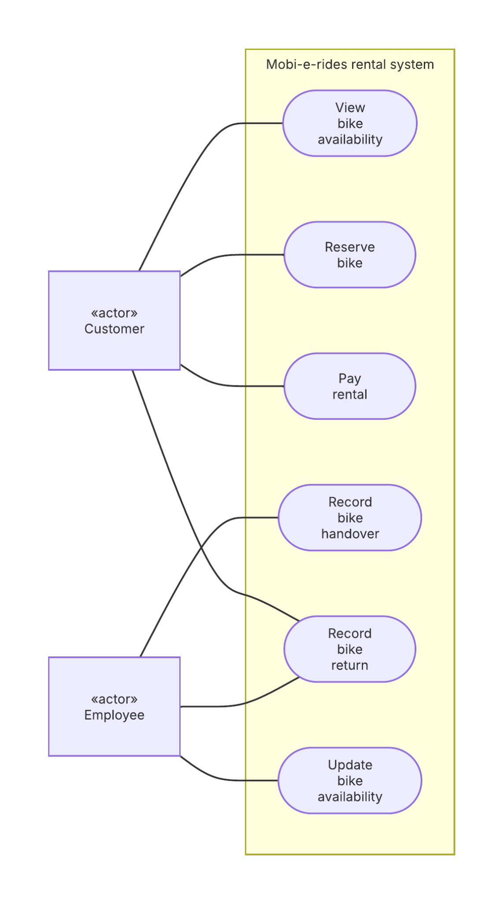
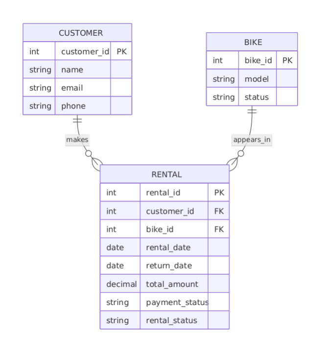
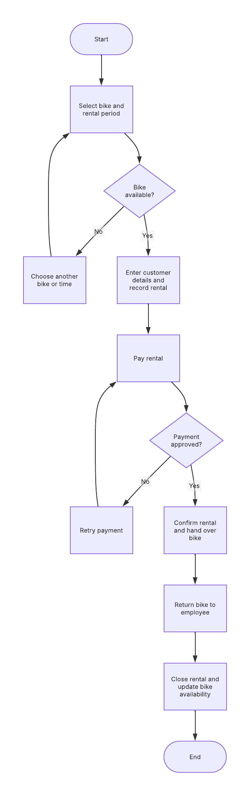

# Mobi-e-rides — End-to-End Business Analysis Case Study

**Author:** [Rodrigo Garza García](https://www.linkedin.com/in/rodrigogarzamx/)  
**Professional focus:** Public & International Affairs · Business Analysis · Data Analytics  
**Portfolio page:** [mobi e rides business analysis](https://rogarzag.github.io/projects/mobi-e-rides/)  
**GitHub repository:** [mobi-e-rides-business-analysis](https://github.com/rogarzag/mobi-e-rides-business-analysis)  
**Project focus:** End-to-end Business Analysis · Requirements · Stakeholder Identification · UML · ERD · Process Modeling  
**Project context:** IBM Business Analysis coursework; academic portfolio case  
**Data / case coverage:** Proposed bicycle and e-bike rental service in Mexico City  
**Professional links:** [GitHub profile](https://github.com/rogarzag) · [LinkedIn](https://www.linkedin.com/in/rodrigogarzamx/) · [Professional Website](https://rogarzag.github.io/)

## Project Overview

**Business Analysis & Process Modeling**

Mobi-e-rides is a proposed peer-to-peer bicycle and e-bike rental platform in Mexico City. This portfolio case study explores how customers can check bike availability, reserve and pay for a rental, and collect and return a bike with employee assistance.

The project applies business analysis techniques to translate a simple business scenario into requirements and visual models.

## Analysis scope

- Stakeholder identification and interview questions
- Requirements elicitation and MoSCoW prioritization
- Requirements traceability
- Proposed workshops, observation and customer surveys
- Use case, data and process modeling
- Basic risks and validation considerations

## Key requirements

| ID | Requirement | Reflected in the models |
|---|---|---|
| REQ-01 | Customers can reserve a bike for a selected rental period. | Reserve bike; Customer and Rental records |
| REQ-02 | Customers can pay for their rental and receive confirmation. | Pay rental; payment status in Rental |
| REQ-03 | Bike availability is updated throughout the rental cycle. | View and update availability; Bike status |

## Process and system models

The following diagrams present three complementary views of the proposed solution.

### 1. Use Case Diagram

Shows the interactions between the Customer, the Employee and the Mobi-e-rides rental system. The customer participates in the bike return, while the employee records the handover and return in the system.

  

### 2. Entity Relationship Diagram (ERD)

Represents the main data entities — Customer, Bike and Rental — and shows their attributes, primary keys, foreign keys and relationships.

  

### 3. Rental Process Flowchart

Maps the rental journey from bike selection and availability checking to payment, bike handover, return and availability update. It also shows alternative paths when a bike is unavailable or a payment is rejected.

  

## Project document

[View or download the full case study (PDF)](./mobi-e-rides-business-analysis.pdf).

## Project context

This is an academic and portfolio exercise, not a live service or implemented system. Interviews, workshops, observation and surveys are proposed elicitation activities; they have not been conducted. The project does not claim actual user research findings or operating results.

The case builds on the e-bike rental scenario used in IBM Business Analysis coursework and presents a simplified analysis with my own requirements and models.

## Conclusion

The case translates a proposed rental service into three priority requirements and complementary system, data, and process models. Together, the use case diagram, ERD, and rental flowchart provide a concise view of customer and employee interactions, core data, and key process alternatives. This is an academic portfolio exercise: research activities are proposed, and the service has not been implemented.
